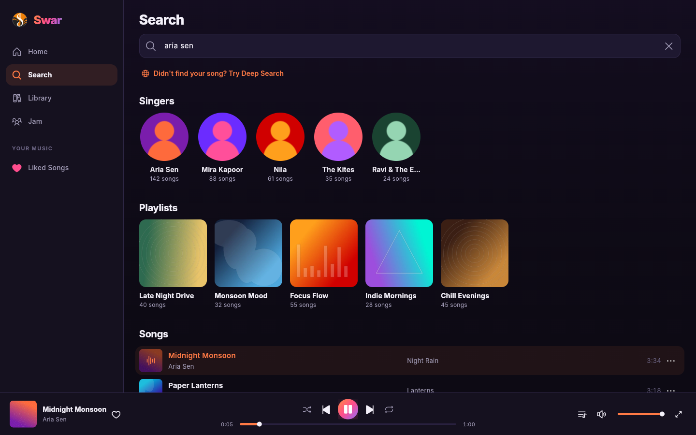
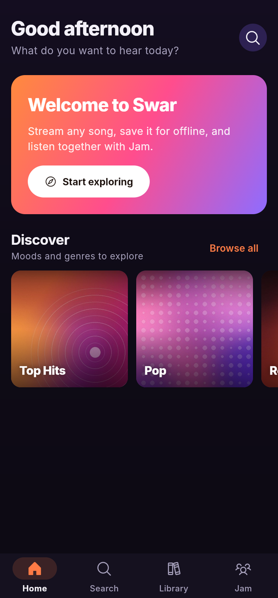
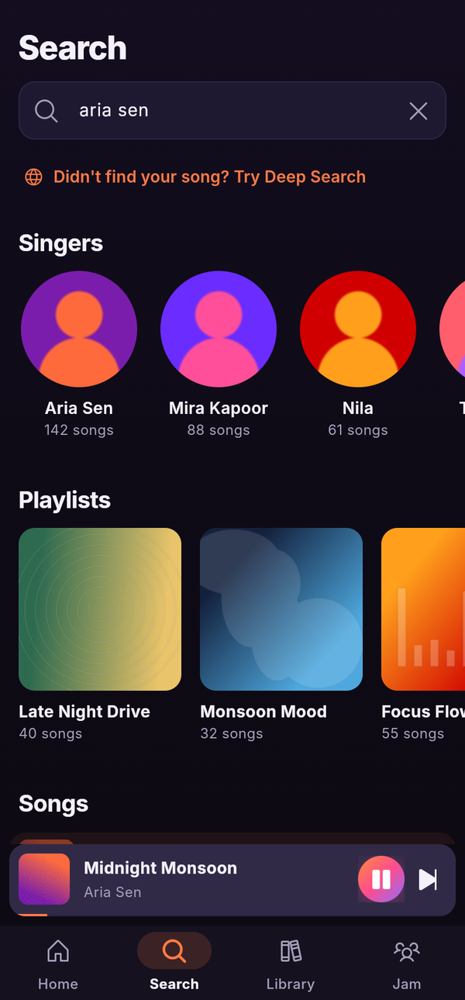
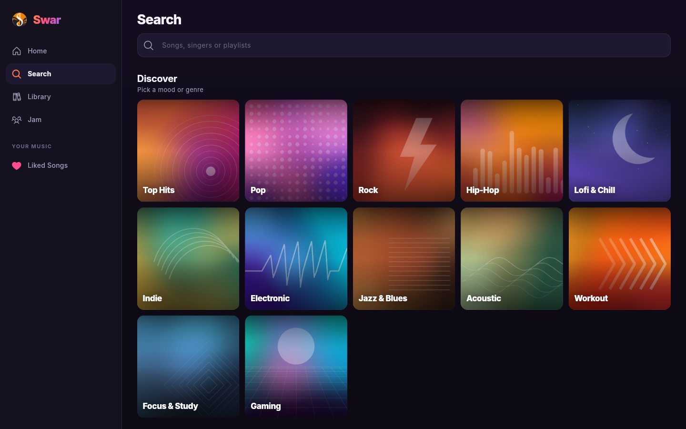
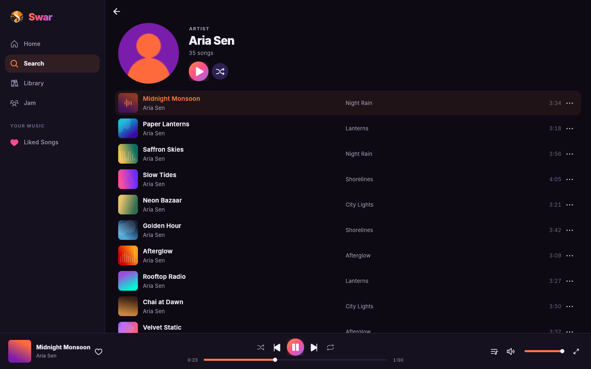
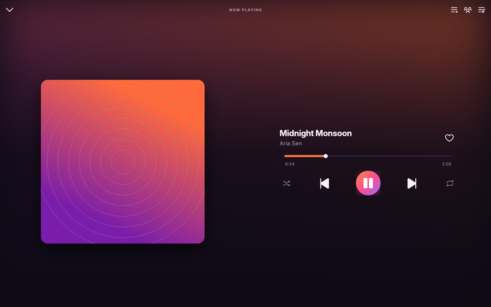

# Swar

Swar is a free music player for Android, Linux, macOS, Windows and the web.
Search a large catalog of Indian and international songs, build playlists,
save songs for offline listening, and listen together with friends in a Jam.
The app is written in Flutter and talks to its own Go server.



<p>
  
  
  
</p>

The screenshots use sample songs and artwork.

## Contents

- [Features](#features)
- [Download](#download)
- [Screenshots](#screenshots)
- [How it works](#how-it-works)
- [Run it yourself](#run-it-yourself)
- [Updates and releases](#updates-and-releases)
- [Project layout](#project-layout)
- [Credits](#credits)
- [Disclaimer](#disclaimer)

## Features

**Listening**
- Search songs, singers and playlists in one place. Singers without songs are
  hidden, and the rest are sorted by how many songs they have.
- Deep Search finds songs the catalog does not have, such as international
  releases, and plays them through the server.
- Artist pages with every song the catalog has for the artist, with Play and
  Shuffle. Tap the artist name in the player to open their page.
- A queue you can reorder, shuffle, repeat, and next-song recommendations that
  follow what you play and skip.
- Radio started from any song.
- Sleep timer: pause after a set time or at the end of the song.
- Picks up where you left off: the queue, song and position come back
  after a restart.
- Background playback with lock screen and notification controls: like,
  previous, play or pause, next and close.

**Your library**
- Liked songs, your own playlists, recently played and most played songs,
  stored on the device.
- Recent searches, one tap to search again.
- Download songs for offline listening.

**Jam**
- Start a Jam and share its code. Everyone hears the same song at the same
  time, and anyone the host allows can add songs to the shared queue.
- "Add to Jam" is in every song's menu, and a Jam can search for songs to add.

**Desktop**
- A sidebar with your playlists, pages that open beside it, and a full-width
  player bar with seek, queue and volume.
- Keyboard shortcuts: Space plays or pauses, Ctrl or Cmd with the left and
  right arrows skips songs, and Ctrl or Cmd with F opens search.

**Updates**
- The app checks for a newer release when it starts and links to the
  installer for your platform. "Check for updates" is in the Library.

## Download

Get the latest build from the
[Releases page](https://github.com/SudhanshuMatrix/Swar/releases/latest).

| Platform | File | Notes |
| --- | --- | --- |
| Android | `Swar-Android.apk`, or the same in `Swar-Android.zip` | Allow installs from your browser or file manager when asked. |
| Windows | `Swar-Setup-<version>.exe`, or the portable `.zip` | On "Windows protected your PC", click More info, then Run anyway. |
| macOS | `Swar-macOS.dmg`, or the app in `Swar-macOS.zip` | The app is not signed. The first time, right-click it and choose Open, or use System Settings, Privacy & Security, Open Anyway. |
| Linux | `swar_<version>_amd64.deb`, or `swar-linux-x64-<version>.tar.gz` | For Ubuntu, Lubuntu and other Debian based systems, 22.04 and newer. `sudo apt install ./swar_<version>_amd64.deb` also installs libmpv, which plays the audio. |

Every push to `master` also builds all platforms. Those test builds are on
the run page in the Actions tab.

## Screenshots

**Discover.** Moods and genres to explore, each with its own cover.



**Artist page.** Every song by the artist, with Play and Shuffle.



**Now playing.** Large artwork, seek bar, and shortcuts to the queue and Jam.



## How it works

```
 Swar app (Flutter)                        Swar server (Go, server/)
 Android, iOS, Linux,      HTTPS + JSON    catalog search (Saavn)
 macOS, Windows, web   <---------------->  Deep Search (yt-dlp)
                           WebSocket       audio relay for Deep Search songs
                       <---------------->  recommendations, radio, library
                           (Jam)           Jam sessions, download tracking
```

- **Catalog.** Searches, artists, playlists and most songs come from the
  Saavn catalog through the server.
- **Deep Search.** When a song is not in the catalog, Deep Search looks it up
  with yt-dlp. The server streams the audio to the app itself, so it plays the
  same way on every platform. When a video is blocked or age restricted, the
  server tries another public upload of the same song.
- **Playback.** The app uses just_audio with audio_service for background
  playback, and libmpv on Linux.
- **Storage.** The library, playlists and settings live on the device in
  Hive. The server keeps an anonymous device token for recommendations, radio
  and Jam.

The hosted server is at `https://swar-urov.onrender.com`, and release builds
use it by default.

## Run it yourself

### Requirements

- Flutter, stable channel (CI uses the latest stable)
- Go 1.24 or newer, for the server
- Python 3 and yt-dlp, for Deep Search: `pip install -U "yt-dlp[default]"`

### The app

The platform folders (`android/`, `linux/`, `macos/`, `windows/`, `web/`) are
generated, not kept in git. Create them once, then run on any device:

```bash
bash scripts/prepare_platforms.sh android,linux,macos,web,windows
flutter pub get
flutter run -d macos          # or linux, windows, chrome, or an Android device
```

The server address comes from `API_BASE_URL` in a `.env` file at the
repository root:

```
API_BASE_URL=https://swar-urov.onrender.com
```

A `--dart-define=API_BASE_URL=...` flag overrides it for one run. For a
server on your own computer, use `http://127.0.0.1:8765`, or
`http://10.0.2.2:8765` from the Android emulator.

Tests and checks:

```bash
flutter analyze
flutter test
```

### The server

```bash
cd server
make run          # starts on :8765, data in ./data/swar.db
make check        # vet, race tests and build
make docker       # container image
```

Settings are environment variables, listed in `server/.env.example`. The ones
that turn on playback:

| Variable | Purpose |
| --- | --- |
| `SAAVN_MEDIA_URLS_ENABLED=true` | Play catalog songs. |
| `DEEPSEARCH_PLAYBACK_ENABLED=true` | Play Deep Search songs. |
| `SAAVN_DOWNLOADS_ENABLED`, `DEEPSEARCH_DOWNLOADS_ENABLED` | Allow offline downloads. |
| `SWAR_ENV=production` with `SWAR_TOKEN_SECRET` | Required for a public deployment. |

Both playback switches are off by default because turning them on is the
operator's decision about streaming rights. Read
[server/docs/DECISIONS.md](server/docs/DECISIONS.md) first.

More about the server:
[API reference](server/docs/API.md),
[deployment and sizing](server/docs/DEPLOYMENT.md),
[design decisions](server/docs/DECISIONS.md).

## Updates and releases

### Making a release

1. Raise `version:` in `pubspec.yaml`, for example from `0.2.0+2` to `0.3.0+3`.
2. Add a section for that version at the top of `CHANGELOG.md`:

   ```markdown
   ## [0.3.0] - 2026-11-02

   ### Added
   - Something new.

   ### Fixed
   - Something that was broken.
   ```

3. Commit and push to `master`.

The Build workflow reads the version. When no tag `v0.3.0` exists yet, it
builds every platform and publishes GitHub Release `v0.3.0` with all files
attached and that changelog section as the release notes. If the changelog
has no section for the new version, the workflow stops with an error that
says so. Pushes that do not change the version only build.

### Releasing by hand

The Release workflow publishes a release without waiting for a push. In the
Actions tab, choose Release, then Run workflow. It builds every platform from
the chosen branch and publishes `v<version>` from `pubspec.yaml`, with that
version's changelog section as the notes.

- Replace: rebuilds and replaces a release that already exists.
- Pre-release: publishes it as a pre-release, which the in-app update check
  skips.

To print the notes a release will get:

```bash
bash scripts/changelog_notes.sh 0.3.0
```

### In-app update check

A few seconds after it starts, the app asks GitHub for the latest release.
When that release is newer than the running version, it shows the changelog
with three choices: Download (opens the installer for the platform), Later,
and Skip this version. Library, About Swar, Check for updates does the same
check on demand. The check is quiet when the device is offline.

Android builds from CI are signed with a new debug key on every run. Until a
fixed release key is added, Android may refuse to install a new APK over an
older one. Uninstall the old version first in that case.

## Project layout

```
lib/
  core/         theme, icons, constants, error messages
  models/       tracks, playlists, artists
  screens/      home, search, library, artist, playlists, Jam, now playing
  services/     server API, audio, downloads, Jam, library storage, updates
  state/        player and library state
  widgets/      player bar, mini player, song tiles, dialogs
server/         Go server: cmd/, internal/, migrations/, docs/
packaging/      Linux .deb and Windows installer scripts
scripts/        platform setup and changelog notes
.github/        Build and Release workflows, one workflow per platform
docs/           screenshots
test/           Flutter tests
```

## Credits

- [Flutter](https://flutter.dev), [just_audio](https://pub.dev/packages/just_audio)
  and [audio_service](https://pub.dev/packages/audio_service)
- [Inter](https://rsms.me/inter/) typeface, SIL Open Font License 1.1
- [Phosphor Icons](https://phosphoricons.com), MIT License
- [yt-dlp](https://github.com/yt-dlp/yt-dlp) for Deep Search

## Disclaimer

Swar is for personal, educational and non-commercial use. Songs come from
third-party services whose terms may apply. You are responsible for how you
use this software and for the settings you turn on when you run the server.
